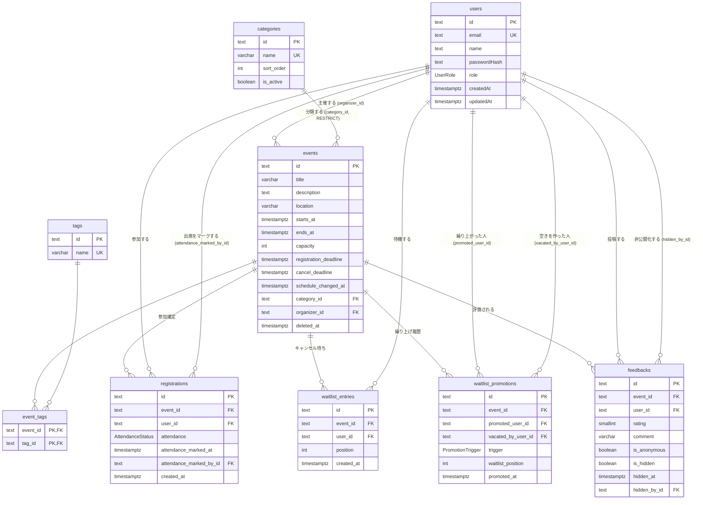

# 社内イベント参加登録システム マニフェスト

本書はこのプロジェクトの **仕様の正本** です。実装・レビューはこのマニフェストに沿って行い、仕様を変える場合は先に本書を更新してからコードを変更します。

- 元資料: 「社内イベント参加登録システム(拡張版) 課題仕様書」
- コード規約: `docs/coding_standards.md` / プロジェクトルール: `CLAUDE.md` / 構成の理由: `docs/ARCHITECTURE.md`
- 表記: 「Must」= 必須、「Should」= 推奨。日時は特記なき限り UTC で保存・送受信し、画面では JST で表示する。

---

## 目次

1. [プロジェクト概要](#1-プロジェクト概要)
2. [ユーザーロールと権限](#2-ユーザーロールと権限)
3. [要求リスト](#3-要求リスト)
4. [業務ルールと設計判断](#4-業務ルールと設計判断)
5. [API設計](#5-api設計)
6. [DB設計](#6-db設計)
7. [画面設計](#7-画面設計)
8. [技術スタック・ディレクトリ構成](#8-技術スタックディレクトリ構成)
9. [開発環境(Docker)](#9-開発環境docker)
10. [テスト方針](#10-テスト方針)
11. [実装状況・未実装項目](#11-実装状況未実装項目)

---

## 1. プロジェクト概要

社内で開催される勉強会・懇親会・講演会・研修などのイベントを社員が主催・告知し、他の社員がオンラインで参加登録できる社内イベント運営プラットフォーム。

| 利用者 | 主な目的 |
| --- | --- |
| 一般社員 (member) | イベントを探して参加登録する。参加履歴を振り返り、フィードバックを投稿する |
| 主催者 (イベントを作成した member) | 自分のイベントを作成・編集し、参加者と出席状況を管理する |
| 運営担当 (admin) | 全イベントを俯瞰し、不適切なイベント・レビューを削除/非公開化する。カテゴリマスタを管理する |

スコープ外: 通知の実送信(メール・Slack)、ユーザー登録・招待、パスワード変更、モバイル最適化、多言語対応。通知が必要な箇所はログ出力のみ行う。

---

## 2. ユーザーロールと権限

### 2-1. ロール

| ロール | 値 | 説明 |
| --- | --- | --- |
| member | `MEMBER` | 全社員のデフォルト。イベントを作成すると、**そのイベントに対してのみ** 主催者権限を持つ |
| admin | `ADMIN` | 全イベント・全ユーザーを操作可能。カテゴリマスタ管理とレビュー非公開化を担当 |

- 「主催者」は独立したロールではない。`events.organizer_id = ログインユーザーID` であることを主催者判定とする。
- テンプレートのロール `USER` は `MEMBER` にリネームする(マイグレーションで enum 値を変更)。
- JWT のペイロードは `sub`(ユーザーID)と `role` のみ。主催者かどうかはトークンに入れず、リクエストごとに DB のイベントから判定する(主催者はイベント単位で変わるため)。

### 2-2. 権限マトリクス

「主催者」= そのイベントの `organizerId` が自分である member。admin が自分でイベントを作成した場合も主催者ルールが適用される。

| 操作 | member(参加者として) | member(主催者として) | admin |
| --- | --- | --- | --- |
| ログイン / ログアウト | ○ | ○ | ○ |
| イベント一覧・詳細閲覧 | ○ | ○ | ○ |
| イベント作成 | ○(作成者が主催者になる) | - | ○ |
| イベント編集・削除 | ✕ | ○(自分の) | ○(全て) |
| 参加者一覧(出席状況・待機リスト込み)の閲覧 | ✕(氏名のみ) | ○(自分の) | ○ |
| 参加登録・キャンセル(期限内) | ○ | ✕(自分主催) | ○(自分主催以外) |
| キャンセル待ち登録・解除 | ○ | ✕(自分主催) | ○(自分主催以外) |
| 他人の参加の強制キャンセル(期限後も可) | ✕ | ✕ | ○ |
| 出席マーク | ✕ | ○(自分主催のみ) | ○ |
| フィードバック投稿・編集(条件充足時) | ○ | ✕(自分主催) | ○(条件充足時) |
| 匿名レビューの投稿者閲覧 | ✕ | ✕ | ○ |
| 非公開レビューの閲覧 | ✕ | ✕ | ○ |
| カテゴリマスタ管理 | ✕ | ✕ | ○ |
| 不適切レビューの非公開化 | ✕ | ✕ | ○ |

### 2-3. 権限判定の実装方針

- 未ログインで呼べるのは `POST /api/auth/login` と `GET /api/health` のみ。それ以外の全ルートに `requireAuth` を付ける。
- admin 専用ルートはルート定義で `requireRole("ADMIN")` を付ける(カテゴリ管理、レビュー非公開化、強制キャンセル)。
- イベント単位の権限(主催者 or admin)は `backend/src/services/policies/event-policy.ts` の関数に集約し、各サービスが必ずこれを通す。個別に `if` を書かない。
  - `canManageEvent(actor, event)`: `actor.role === "ADMIN" || event.organizerId === actor.id`
  - `assertCanManageEvent(actor, event)`: 上記が false なら `AppError("FORBIDDEN")`
- イベントは社内全員に公開される情報なので、他人のイベントを編集しようとした場合は **404 ではなく 403** を返す(テンプレートの「他人のデータは 404」ルールは非公開データ向け。イベントは閲覧できる以上、存在を隠す意味がない)。
- 論理削除済みイベントは誰に対しても 404。

---

## 3. 要求リスト

ID の接頭辞: AUTH = 認証、EV = イベント、REG = 参加登録、CAT = カテゴリ・タグ、ATT = 出席、WL = キャンセル待ち、FB = フィードバック、NF = 非機能。

### 3-1. 認証(Must)

| ID | 要求 |
| --- | --- |
| AUTH-01 | メールアドレス + パスワードでログインできる |
| AUTH-02 | JWT でセッションを管理する。トークンは httpOnly Cookie に格納する(XSS でトークンを読まれないため) |
| AUTH-03 | トークンにロール(MEMBER / ADMIN)を含める |
| AUTH-04 | ログアウトできる(Cookie を削除) |
| AUTH-05 | ユーザーは seed で作成する。サインアップ API・画面は削除する(招待制・登録機能は不要との仕様) |
| AUTH-06 | パスワードは bcrypt(12 ラウンド)でハッシュ化して保存する。平文保存禁止 |
| AUTH-07 | ログイン失敗時、メール不存在とパスワード誤りを区別しないメッセージを返す。ログインは IP 単位でレート制限する |
| AUTH-08 | 未ログインで保護ページにアクセスすると `/login` にリダイレクトし、ログイン後に元のページへ戻る |

### 3-2. イベント基本機能(Must)

| ID | 要求 |
| --- | --- |
| EV-01 | イベント一覧を表示する。カテゴリ絞り込み、キーワード検索(タイトル・説明文の部分一致、大文字小文字無視)、タグ検索、開催日順ソート(昇順/降順)ができる |
| EV-02 | 一覧はデフォルトで「これから開催されるイベント」を開催日昇順で表示し、「過去のイベントも表示」で開催済みも含める。ページングあり(既定 20 件、最大 50 件) |
| EV-03 | 一覧の各カードに タイトル・カテゴリ・タグ・開催日時・主催者名・定員・登録者数・空き数・自分の状態(参加確定/待機中/主催) を表示する |
| EV-04 | イベント詳細に 基本情報 + 参加者リスト + 空き状況 + キャンセル待ち人数 + 平均評価 を表示する |
| EV-05 | 全 member がイベントを作成できる。作成者が主催者になる |
| EV-06 | 主催者本人と admin のみがイベントを編集・削除できる |
| EV-07 | 過去日時のイベントは作成できない(バリデーションエラー) |
| EV-08 | 編集で開催日時を変更したとき、参加確定者がいれば警告を出す(→ 4-4) |
| EV-09 | 削除は論理削除とする(→ 4-3) |
| EV-10 | マイイベント一覧: 自分が主催中のイベント、参加登録中のイベント、キャンセル待ち中のイベント、参加履歴 を表示する |

### 3-3. 参加登録・キャンセル(Must)

| ID | 要求 |
| --- | --- |
| REG-01 | イベントに参加登録できる |
| REG-02 | 参加登録をキャンセルできる |
| REG-03 | 各イベントの現在の登録者数・空き数を表示する |
| REG-04 | 定員に達したイベントには通常の参加登録ができない(キャンセル待ちに誘導) |
| REG-05 | 登録締切を過ぎたイベントには登録できない。未設定時の締切は開催開始日時 |
| REG-06 | キャンセル期限を過ぎたら本人はキャンセルできない。未設定時の期限は開催開始日時。admin は期限後も強制キャンセルできる |
| REG-07 | 開催開始済み(過去)のイベントには登録できない |
| REG-08 | 同一ユーザーの二重登録を防ぐ(アプリ判定 + DB 一意制約の二重防御) |
| REG-09 | 主催者は自分のイベントに参加登録できない(→ 4-2) |

### 3-4. カテゴリ・タグ(Must)

| ID | 要求 |
| --- | --- |
| CAT-01 | 各イベントは必ず 1 つのカテゴリを持つ(初期値: 勉強会 / 懇親会 / 講演会 / 研修 / その他) |
| CAT-02 | 各イベントは 0〜10 個のタグを持てる(自由入力、正規化ルールは 4-6) |
| CAT-03 | 一覧画面でカテゴリ絞り込み・タグ検索ができる |
| CAT-04 | admin はカテゴリマスタを追加・編集・削除できる |
| CAT-05 | イベントが紐づくカテゴリは物理削除できない。代わりに無効化する(→ 4-5) |
| CAT-06 | タグは中間テーブル `event_tags` による多対多で実装し、タグ側からの検索用インデックスを張る |

### 3-5. 出席管理(Must)

| ID | 要求 |
| --- | --- |
| ATT-01 | 主催者と admin は、開催開始日時以降に参加確定者を「出席」「欠席(ドタキャン)」にマークできる |
| ATT-02 | 開催開始日時より前の出席マークは禁止(バリデーションエラー) |
| ATT-03 | マーク後も変更できる(未マークに戻すことも可能。誤操作リカバリ) |
| ATT-04 | 参加者一覧に各人の出席状態を表示する(主催者・admin 向け画面) |
| ATT-05 | マイページに 累計参加数・出席率・カテゴリ別参加傾向 を表示する(定義は 4-8) |
| ATT-06 | 出席率 = 出席回数 ÷ (出席回数 + 欠席回数)。未マークは分母から除外。分母 0 のときは「-」表示(API は `null`) |

### 3-6. キャンセル待ち + 自動繰り上げ(Should)

| ID | 要求 |
| --- | --- |
| WL-01 | 満席時、参加登録ボタンが「キャンセル待ちに登録」に切り替わる |
| WL-02 | キャンセル待ちは待機順(position)を持ち、画面には「n 番目」を表示する |
| WL-03 | 参加確定者がキャンセルすると、先頭の待機者を自動で参加確定に繰り上げる。キャンセル削除と繰り上げは 1 トランザクション |
| WL-04 | 待機中のユーザーはいつでも待機解除できる。解除後も順番の整合性を保つ(→ 4-7) |
| WL-05 | 繰り上げ履歴(いつ・誰が・誰の空きで繰り上がったか・きっかけ)を保存する |
| WL-06 | 繰り上げ時は通知の代わりにログを出力する(将来の通知機能の差し込み口) |
| WL-07 | 主催者が定員を増やした場合も、増えた枠の分だけ待機者を繰り上げる |

### 3-7. フィードバック(Should)

| ID | 要求 |
| --- | --- |
| FB-01 | 開催終了済み かつ 出席マーク済み(出席)のユーザーは、1〜5 の星評価 + 一言コメントを投稿できる |
| FB-02 | 1 イベントにつき 1 人 1 件。2 件目の投稿は不可、自分の投稿の編集は可 |
| FB-03 | イベント詳細に平均評価(小数第 1 位)と件数、レビュー一覧を表示する |
| FB-04 | 投稿時に匿名フラグを選べる。匿名投稿の投稿者は一般ユーザーには表示せず、admin には表示する |
| FB-05 | admin は不適切なレビューを非公開化・再公開できる |
| FB-06 | 非公開レビューは平均評価・件数の集計から除外し、一般ユーザーの一覧にも出さない(admin には「非公開」ラベル付きで表示) |

### 3-8. 非機能(Must)

| ID | 要求 |
| --- | --- |
| NF-01 | 全入力を Zod で検証する。スキーマは `shared/` に置き、フロントのフォームでも同じスキーマを使う |
| NF-02 | 想定外のリクエストで 500 を返さない(バリデーション・存在チェック・一意制約違反をそれぞれ 4xx に変換) |
| NF-03 | SQL は Prisma のクエリビルダか `$queryRaw` タグ付きテンプレート(パラメータ化)のみ。文字列連結の SQL を書かない |
| NF-04 | React の自動エスケープに任せ、`dangerouslySetInnerHTML` を使わない。説明文の改行は CSS(`white-space: pre-wrap`)で表現する |
| NF-05 | パスワード・トークン・Cookie・リクエストボディをログに出さない |
| NF-06 | DB の日時は `timestamptz`(UTC)、API は ISO 8601(UTC, `Z` 付き)、画面表示は JST(`Asia/Tokyo`) |
| NF-07 | `docker compose up -d` だけで DB / backend / frontend が起動し、マイグレーションと seed が適用される |

---

## 4. 業務ルールと設計判断

### 4-1. 日時の扱いと「期限」の定義

| 用語 | 定義 |
| --- | --- |
| 開催開始 | `events.starts_at` |
| 開催終了 | `events.ends_at`(必須。`ends_at > starts_at`)。フィードバックの「開催終了済み」判定に使う |
| 登録締切 | `registration_deadline ?? starts_at`。`now >= 締切` なら登録不可 |
| キャンセル期限 | `cancel_deadline ?? starts_at`。`now >= 期限` なら本人キャンセル不可 |

- 締切・期限は、設定する場合は `<= starts_at` でなければならない。
- 判定に使う「現在時刻」はサーバー時刻のみ。クライアントの時刻は信用しない(フロントのボタン制御は UX 用の補助)。
- フロントの `datetime-local` 入力値は JST とみなして UTC の ISO 文字列に変換して送る。変換関数は `frontend/src/utils/datetime.ts` に 1 つだけ置く。

### 4-2. 主催者は参加者として登録しない

- 主催者は `registrations` に行を持たず、定員・登録者数・出席率の集計にも含めない。登録 API を主催者が呼んだら `403 ORGANIZER_CANNOT_REGISTER`。
- 理由:
  - 「定員」は参加者の枠であり、主催者を含めると定員の意味が主催者ごとに変わる。
  - 主催者を自動で参加確定にすると、出席マーク・フィードバック(主催者は投稿不可)・出席率の各所で主催者を除外する分岐が必要になり、漏れやすい。`organizer_id` で一元管理する方が判定が単純。
- 詳細画面では参加者リストとは別に「主催者」として表示する。

### 4-3. イベント削除は論理削除

- `DELETE /api/events/:id` は `deleted_at` に現在時刻を入れる。削除済みイベントは一覧・詳細・マイページ・集計から除外し、API は 404 を返す。
- 理由:
  - 参加登録・繰り上げ履歴・フィードバックが `events` を外部キー参照しており、物理削除だとカスケードで履歴ごと消える。admin が誤って削除した際に DB から復旧できるよう残す。
  - 「不適切なイベントの削除」は監査の観点でも記録を残す方が安全。
- 削除済みイベントの参加登録・待機は残すが、無効なデータとして扱う(どの API からも参照しない)。
- 削除時に参加確定者・待機者がいれば、通知の代わりに件数をログ出力する。
- 復元 API は作らない(スコープ外)。

### 4-4. 開催日時変更時の警告

- 編集で `starts_at` または `ends_at` が変わり、参加確定者が 1 人以上いる場合:
  1. `logger.warn` で「イベントID・旧日時・新日時・参加確定者数」を出力する(通知送信の代わり)。
  2. `events.schedule_changed_at` に現在時刻を記録する。詳細画面は参加確定者に「開催日時が変更されました」バナーを表示する。
  3. 更新 API のレスポンスに `warnings: [{ code: "SCHEDULE_CHANGED_WITH_PARTICIPANTS", participantCount }]` を含め、編集画面がトーストで主催者に知らせる。
- 編集画面は保存前にも、参加確定者がいる状態で日時を変えたら確認ダイアログを出す。
- 開催開始後は `starts_at` / `ends_at` / `capacity` / 締切・期限を変更できない(`409 EVENT_ALREADY_STARTED`)。タイトル・説明・場所・カテゴリ・タグは変更可。
- 開催日時を変更する場合、新しい `starts_at` も未来でなければならない(EV-07 と同じ)。

### 4-5. カテゴリ削除: 使用中は削除拒否 + 無効化

- `DELETE /api/categories/:id` は、そのカテゴリを参照するイベント(論理削除済みを含む)が 1 件でもあれば `409 CATEGORY_IN_USE` を返す。参照がなければ物理削除する。
- 使用中のカテゴリを使わせたくない場合は `PATCH /api/categories/:id` で `isActive: false` にする。無効カテゴリは新規作成・編集の選択肢と一覧の絞り込み候補から消えるが、既存イベントの表示には残る。
- DB 側も `events.category_id` を `ON DELETE RESTRICT` にして、アプリのチェック漏れがあっても孤児イベントが生まれないようにする。
- 理由: 「別カテゴリへ自動移動」は主催者の意図しない分類変更になり、カテゴリ別参加傾向の過去データも書き換わる。論理削除だけにすると、使われていない誤登録カテゴリまで永久に残る。「未使用なら消せる / 使用中なら無効化」が整合性と運用のバランスが最もよい。
- カテゴリ名は一意(大文字小文字は区別しない比較で重複チェック)。

### 4-6. タグの正規化

- 入力値を `trim` → Unicode NFKC 正規化 → 英字を小文字化 → 連続空白を 1 つに、の順で正規化してから保存・検索する(「React」「react」「ＲＥＡＣＴ」を同一タグにするため)。
- 1 タグ 1〜20 文字、1 イベント最大 10 個。正規化後に重複したものは 1 つにまとめる。
- タグは `tags` テーブルに一意な名前で保存し、`event_tags` で多対多。イベント保存時に未登録のタグは `upsert` で作る。
- イベントから外れて使われなくなったタグは削除しない(オートコンプリート候補として残す。件数が問題になったら定期削除ジョブを検討)。
- タグ検索は正規化後の完全一致。

### 4-7. 参加登録・キャンセル待ちの整合性

**テーブル構成**: 参加確定は `registrations`、待機は `waitlist_entries` の別テーブルにする。参加確定には出席状態があり、待機には順番がある、と持つ属性が違うため。同じユーザーが両方に同時に存在しないことはサービス層で保証する。

**同時実行制御**: 参加登録・キャンセル・待機登録・待機解除・定員変更の各処理は、すべて Prisma の対話的トランザクション内で最初に `SELECT id FROM events WHERE id = $1 FOR UPDATE` を実行し、**イベント単位で直列化** する。これにより、

- 「空き 1 に 2 人が同時に登録して定員超過」
- 「同時キャンセル 2 件で同じ待機者が 2 回繰り上がる」
- 「待機登録の同時実行で position が重複」

を防ぐ。さらに DB の一意制約(`(event_id, user_id)`、`(event_id, position)`)を最後の砦とし、Prisma の `P2002` を `409 ALREADY_REGISTERED` に変換する。

**待機順(position)の方式: 単調増加 + 表示時に順位を計算**

- 待機登録時、`position = そのイベントの過去最大 position + 1`(行ロック下で採番)。一度振った番号は付け直さない。
- 誰かが待機解除・繰り上げで抜けても、他の行は更新しない。番号に欠番ができるだけで、`position` の昇順という順序関係は常に正しい。
- 画面に出す「n 番目」は `position` 昇順で数えた順位(`ROW_NUMBER()` 相当)を API が計算して返す。
- 理由: 解除のたびに後続の position を `-1` する方式は、多数行の UPDATE が発生し、一意制約との組み合わせで更新順序によっては一時的に重複して失敗する。単調増加なら INSERT / DELETE だけで済み、整合性が崩れる余地がない。
- 待機解除してから再登録した場合は最後尾になる。

**参加登録 `POST /api/events/:eventId/registration` の判定順**

1. イベントが存在し未削除か(404)
2. 自分が主催者でないか(403 `ORGANIZER_CANNOT_REGISTER`)
3. 開催開始前 かつ 登録締切前か(409 `REGISTRATION_CLOSED`)
4. 既に参加確定 or 待機中でないか(409 `ALREADY_REGISTERED`)
5. 空きがあるか(なければ 409 `EVENT_FULL`。クライアントはキャンセル待ちに切り替える)
6. `registrations` に INSERT

**キャンセル待ち登録 `POST /api/events/:eventId/waitlist`** は 1〜4 を同様に確認し、5 で **空きがある場合は** 409 `SEATS_AVAILABLE`(通常登録すべきため)、満席なら `waitlist_entries` に INSERT。

**キャンセル(本人)`DELETE /api/events/:eventId/registration`** — 1 トランザクション:

1. イベント行をロック
2. 自分の参加確定行を取得(なければ 404)
3. キャンセル期限前か(409 `CANCEL_DEADLINE_PASSED`)
4. 参加確定行を DELETE
5. 開催開始前なら、`position` 最小の待機者を取得し、存在すれば: 参加確定行を INSERT → 待機行を DELETE → `waitlist_promotions` に履歴を INSERT(`trigger = CANCELLATION`, `vacated_by_user_id = キャンセルした人`)→ 繰り上げログ出力
6. コミット。途中で失敗したらすべてロールバック

**強制キャンセル(admin)`DELETE /api/events/:eventId/registrations/:registrationId`** は 3 の期限チェックを行わない以外は同じ。履歴の `trigger = ADMIN_CANCELLATION`。

**定員変更**: 編集で定員を増やしたら、同じトランザクションで `min(増えた空き数, 待機人数)` 人を position 順に繰り上げる(`trigger = CAPACITY_INCREASE`, `vacated_by_user_id = null`)。現在の参加確定者数より小さい定員には変更できない(409 `CAPACITY_BELOW_REGISTERED`)。

**繰り上げのタイミング**: 開催開始前なら、登録締切後でも繰り上げる(待機者は締切前に申し込み済みのため)。開催開始後のキャンセル(admin の強制キャンセル)では繰り上げない。

**キャンセル済みの扱い**: キャンセルは `registrations` の行を物理削除する。参加履歴に残す必要がない(キャンセルは「参加」ではない)ため。キャンセル後の再登録は可能(通常の判定を通る)。繰り上げの事実は `waitlist_promotions` に残る。

### 4-8. 出席・集計の定義

| 指標 | 定義 |
| --- | --- |
| 出席マーク可能 | `now >= starts_at`。それ以前は 400 `EVENT_NOT_STARTED`(仕様上の「バリデーションエラー」) |
| 出席状態 | `UNMARKED`(未マーク, 初期値)/ `PRESENT`(出席)/ `ABSENT`(欠席)。いつでも相互に変更可 |
| 累計参加数 | 開催開始済み・未削除のイベントのうち、自分が参加確定で `ABSENT` 以外のもの(`PRESENT` + `UNMARKED`)の件数。主催者がマークし忘れても参加として数えるため |
| 出席率 | `PRESENT ÷ (PRESENT + ABSENT)`。分母 0 なら `null`。0〜1 の数値で返し、画面で % 表示 |
| カテゴリ別参加傾向 | 累計参加数と同じ母集団をカテゴリ別に件数集計(無効化カテゴリも含む) |

- 出席マーク時は `attendance_marked_at` と `attendance_marked_by_id` を記録する(誰がいつマークしたかの追跡用)。

### 4-9. フィードバック

- 投稿条件(すべて満たす): イベントが未削除 / `now >= ends_at` / 自分の参加確定行があり `attendance = PRESENT` / 自分が主催者でない / 未投稿。
  - 条件不足は 403 `FEEDBACK_NOT_ALLOWED`(メッセージで理由を区別)、投稿済みは 409 `FEEDBACK_ALREADY_EXISTS`。
- 編集は本人のみ。編集時も「出席」状態であることを再確認する(後から欠席に修正された場合は編集不可)。
- 出席が後から `ABSENT` / `UNMARKED` に変わっても、既存のフィードバックは削除しない(admin が非公開化で対応)。
- 匿名: 一般ユーザー向けレスポンスでは `author: null`。admin 向けには `author` を含め、`isAnonymous: true` を付ける。本人の投稿は `GET` で `isMine: true` が付く。
- 非公開化: `is_hidden = true`, `hidden_at`, `hidden_by_id` を記録。非公開レビューは一般ユーザーの一覧から除外(本人には自分の投稿として「非公開」状態で見える)、平均・件数の集計から除外。
- 平均評価は `AVG(rating) WHERE is_hidden = false` を小数第 1 位に丸める。0 件なら `null`。

---

## 5. API設計

### 5-1. 共通仕様

- ベースパス: `/api`。JSON のみ。認証は Cookie `token`(httpOnly, SameSite=Lax, 本番は Secure)。
- 成功: `{ "data": ... }`。作成は 201、削除・解除は 204(ボディなし)、それ以外は 200。
- 失敗: `{ "error": { "code": string, "message": string, "details"?: [{ "field": string, "message": string }] } }`
- ID は cuid 文字列。パスパラメータも Zod で検証し、形式不正は 400。
- 日時は ISO 8601 UTC 文字列(例 `2026-12-01T09:00:00.000Z`)。
- 一覧のページング: クエリ `page`(1 始まり, 既定 1)、`limit`(既定 20, 最大 50)。レスポンスは `{ data: { items, total, page, limit } }`。

### 5-2. エラーコード

`shared/src/api.ts` の `ERROR_STATUS` に定義する(コードとステータスの対応はここだけ)。

| code | status | 発生条件 |
| --- | --- | --- |
| `VALIDATION_ERROR` | 400 | 入力形式不正、過去日時でのイベント作成、締切 > 開催日時 など |
| `EVENT_NOT_STARTED` | 400 | 開催開始前の出席マーク |
| `INVALID_CREDENTIALS` | 401 | ログイン失敗 |
| `UNAUTHENTICATED` | 401 | 未ログイン・トークン無効 |
| `FORBIDDEN` | 403 | 権限なし(他人のイベント編集、admin 専用操作 など) |
| `ORGANIZER_CANNOT_REGISTER` | 403 | 主催者が自分のイベントに登録・待機しようとした |
| `FEEDBACK_NOT_ALLOWED` | 403 | フィードバック投稿条件を満たさない |
| `NOT_FOUND` | 404 | リソースが存在しない・論理削除済み・自分の登録がない |
| `ROUTE_NOT_FOUND` | 404 | 未定義のルート |
| `ALREADY_REGISTERED` | 409 | 既に参加確定 or 待機中 |
| `EVENT_FULL` | 409 | 満席で通常登録できない |
| `SEATS_AVAILABLE` | 409 | 空きがあるのにキャンセル待ちに登録しようとした |
| `REGISTRATION_CLOSED` | 409 | 登録締切後・開催開始後 |
| `CANCEL_DEADLINE_PASSED` | 409 | キャンセル期限後の本人キャンセル |
| `EVENT_ALREADY_STARTED` | 409 | 開催開始後に日時・定員・締切を変更しようとした |
| `CAPACITY_BELOW_REGISTERED` | 409 | 参加確定者数より小さい定員への変更 |
| `CATEGORY_IN_USE` | 409 | イベントが紐づくカテゴリの削除 |
| `CATEGORY_NAME_TAKEN` | 409 | カテゴリ名の重複 |
| `FEEDBACK_ALREADY_EXISTS` | 409 | 同じイベントへの 2 件目の投稿 |
| `RATE_LIMITED` | 429 | ログイン試行回数超過 |
| `INTERNAL_ERROR` | 500 | 想定外のエラー(詳細はログのみ、レスポンスには出さない) |

テンプレートの `EMAIL_TAKEN` はサインアップ削除に伴い削除する。

### 5-3. 共通の型(レスポンス)

```ts
type UserSummary = { id: string; name: string };

type User = { id: string; email: string; name: string; role: "MEMBER" | "ADMIN"; createdAt: string };

type Category = { id: string; name: string; sortOrder: number; isActive: boolean };

/** ログインユーザーから見たイベントとの関係 */
type MyEventStatus =
  | { kind: "ORGANIZER" }
  | { kind: "REGISTERED"; registrationId: string }
  | { kind: "WAITLISTED"; rank: number }   // rank = 1 始まりの待機順位
  | { kind: "NONE" };

type EventSummary = {
  id: string;
  title: string;
  category: Category;
  tags: string[];
  startsAt: string;
  endsAt: string;
  location: string | null;
  capacity: number;
  registeredCount: number;
  remainingSeats: number;        // max(capacity - registeredCount, 0)
  waitlistCount: number;
  organizer: UserSummary;
  myStatus: MyEventStatus;
};

type EventDetail = EventSummary & {
  description: string;
  registrationDeadline: string | null;  // 未設定は null(実効値は startsAt)
  cancelDeadline: string | null;
  scheduleChangedAt: string | null;
  participants: UserSummary[];          // 参加確定者(氏名のみ、登録順)
  rating: { average: number | null; count: number };
  permissions: {                        // ボタン表示制御用。サーバー側でも必ず再判定する
    canEdit: boolean;
    canManageAttendance: boolean;
    canRegister: boolean;
    canJoinWaitlist: boolean;
    canCancel: boolean;
    canLeaveWaitlist: boolean;
    canPostFeedback: boolean;
  };
  createdAt: string;
  updatedAt: string;
};
```

### 5-4. エンドポイント一覧

| # | メソッド | パス | 権限 | 概要 | Must/Should |
| --- | --- | --- | --- | --- | --- |
| A1 | POST | `/api/auth/login` | 公開 | ログイン | Must |
| A2 | POST | `/api/auth/logout` | 公開 | ログアウト | Must |
| A3 | GET | `/api/auth/me` | ログイン | ログイン中ユーザー取得 | Must |
| E1 | GET | `/api/events` | ログイン | イベント一覧(検索・絞り込み・ソート) | Must |
| E2 | GET | `/api/events/:eventId` | ログイン | イベント詳細 | Must |
| E3 | POST | `/api/events` | ログイン | イベント作成 | Must |
| E4 | PATCH | `/api/events/:eventId` | 主催者 / admin | イベント編集 | Must |
| E5 | DELETE | `/api/events/:eventId` | 主催者 / admin | イベント削除(論理) | Must |
| R1 | POST | `/api/events/:eventId/registration` | ログイン(主催者除く) | 自分の参加登録 | Must |
| R2 | DELETE | `/api/events/:eventId/registration` | ログイン | 自分の参加キャンセル | Must |
| R3 | GET | `/api/events/:eventId/registrations` | 主催者 / admin | 参加者一覧(出席状態・待機リスト込み) | Must |
| R4 | DELETE | `/api/events/:eventId/registrations/:registrationId` | admin | 強制キャンセル | Must |
| R5 | PUT | `/api/events/:eventId/registrations/:registrationId/attendance` | 主催者 / admin | 出席マーク | Must |
| W1 | POST | `/api/events/:eventId/waitlist` | ログイン(主催者除く) | キャンセル待ち登録 | Should |
| W2 | DELETE | `/api/events/:eventId/waitlist` | ログイン | キャンセル待ち解除 | Should |
| F1 | GET | `/api/events/:eventId/feedbacks` | ログイン | レビュー一覧 + 平均評価 | Should |
| F2 | POST | `/api/events/:eventId/feedback` | ログイン(条件充足者) | 自分のフィードバック投稿 | Should |
| F3 | PATCH | `/api/events/:eventId/feedback` | 投稿者本人 | 自分のフィードバック編集 | Should |
| F4 | PATCH | `/api/feedbacks/:feedbackId/visibility` | admin | 非公開化・再公開 | Should |
| C1 | GET | `/api/categories` | ログイン | カテゴリ一覧 | Must |
| C2 | POST | `/api/categories` | admin | カテゴリ追加 | Must |
| C3 | PATCH | `/api/categories/:categoryId` | admin | カテゴリ編集・有効/無効切替 | Must |
| C4 | DELETE | `/api/categories/:categoryId` | admin | カテゴリ削除(未使用時のみ) | Must |
| T1 | GET | `/api/tags` | ログイン | タグ候補(オートコンプリート) | Must |
| M1 | GET | `/api/me/events` | ログイン | マイイベント一覧 | Must |
| M2 | GET | `/api/me/stats` | ログイン | 累計参加数・出席率・カテゴリ別集計 | Must |
| H1 | GET | `/api/health` | 公開 | ヘルスチェック(テンプレート既存) | - |

命名ルール: リソースは複数形(`events`, `registrations`)。「ログインユーザー自身の 1 件」を指す場合は単数形のサブリソース(`/registration`, `/waitlist`, `/feedback`)を使い、URL にユーザー ID を入れない(他人の ID を指定できる余地をなくすため)。

### 5-5. エンドポイント詳細

#### A1. `POST /api/auth/login`

- Body: `{ email: string(email, trim, lowercase), password: string(1..72) }`
- 200: `{ data: User }` + `Set-Cookie: token=...`
- 400 `VALIDATION_ERROR` / 401 `INVALID_CREDENTIALS` / 429 `RATE_LIMITED`

#### A2. `POST /api/auth/logout`

- 204。Cookie を削除する。未ログインでも 204(冪等)。

#### A3. `GET /api/auth/me`

- 200: `{ data: User }` / 401 `UNAUTHENTICATED`

#### E1. `GET /api/events`

- Query:

| 名前 | 型 | 既定 | 説明 |
| --- | --- | --- | --- |
| `q` | string(0..100) | - | タイトル・説明文の部分一致(大文字小文字無視, Prisma `contains` + `mode: "insensitive"`) |
| `categoryId` | cuid | - | カテゴリで絞り込み |
| `tag` | string(1..20) | - | タグ(正規化後の完全一致) |
| `sort` | `startsAt_asc` \| `startsAt_desc` | `startsAt_asc` | 開催日順 |
| `includePast` | `true` \| `false` | `false` | `false` なら `starts_at >= now` のみ |
| `page` / `limit` | int | 1 / 20 | ページング(limit 最大 50) |

- 常に `deleted_at IS NULL`。同時刻のイベントは `id` で二次ソートして順序を安定させる。
- 200: `{ data: { items: EventSummary[], total, page, limit } }`
- 400 `VALIDATION_ERROR`

#### E2. `GET /api/events/:eventId`

- 200: `{ data: EventDetail }`
- 404 `NOT_FOUND`(存在しない・論理削除済み)

#### E3. `POST /api/events`

- Body(`createEventSchema`):

| 項目 | 型・制約 |
| --- | --- |
| `title` | string, trim, 1..100 |
| `description` | string, trim, 1..2000 |
| `location` | string, trim, 0..100, 任意(空文字は null) |
| `startsAt` | ISO 日時, **現在より未来** |
| `endsAt` | ISO 日時, `> startsAt` |
| `capacity` | int, 1..1000 |
| `registrationDeadline` | ISO 日時 \| null, 任意, `<= startsAt` かつ 現在より未来 |
| `cancelDeadline` | ISO 日時 \| null, 任意, `<= startsAt` |
| `categoryId` | cuid, 有効(`isActive`)なカテゴリ |
| `tags` | string[], 0..10 個, 各 1..20 文字(正規化後) |

- 日時の前後関係は Zod の `superRefine` で検証し、`details` に該当フィールド名を入れる。「現在より未来」の判定はサーバー時刻で行う。
- `organizerId` はボディから受け取らず、ログインユーザーを使う(マスアサインメント防止)。
- 201: `{ data: EventDetail }`
- 400 `VALIDATION_ERROR`(過去日時、存在しない/無効なカテゴリ → `details.field = "categoryId"`)

#### E4. `PATCH /api/events/:eventId`

- Body: E3 の全項目を任意にしたもの(`updateEventSchema`)。最低 1 項目。
- 検証は「更新後の値」(既存値とマージしたもの)に対して E3 と同じ前後関係チェックを行う。`startsAt` を変更する場合のみ「未来であること」をチェック。
- 定員変更・繰り上げは 4-7、日時変更警告は 4-4 のとおり。
- 200: `{ data: { event: EventDetail, warnings: Warning[] } }`
  - `Warning = { code: "SCHEDULE_CHANGED_WITH_PARTICIPANTS"; participantCount: number } | { code: "WAITLIST_PROMOTED"; promotedCount: number }`
- 400 `VALIDATION_ERROR` / 403 `FORBIDDEN` / 404 `NOT_FOUND` / 409 `EVENT_ALREADY_STARTED` / 409 `CAPACITY_BELOW_REGISTERED`

#### E5. `DELETE /api/events/:eventId`

- 論理削除(4-3)。開催済みイベントも削除可。
- 204 / 403 `FORBIDDEN` / 404 `NOT_FOUND`

#### R1. `POST /api/events/:eventId/registration`

- Body なし。判定順は 4-7。
- 201: `{ data: { registrationId: string; event: EventDetail } }`
- 403 `ORGANIZER_CANNOT_REGISTER` / 404 / 409 `REGISTRATION_CLOSED` / 409 `ALREADY_REGISTERED` / 409 `EVENT_FULL`

#### R2. `DELETE /api/events/:eventId/registration`

- 4-7 のトランザクションで処理し、必要なら待機者を繰り上げる。
- 204 / 404 `NOT_FOUND`(イベントなし or 自分の登録なし) / 409 `CANCEL_DEADLINE_PASSED`

#### R3. `GET /api/events/:eventId/registrations`

- 200:

```ts
{
  data: {
    registrations: {
      id: string;
      user: UserSummary;
      attendance: "UNMARKED" | "PRESENT" | "ABSENT";
      attendanceMarkedAt: string | null;
      registeredAt: string;
    }[];
    waitlist: { id: string; user: UserSummary; rank: number; joinedAt: string }[];
    summary: { present: number; absent: number; unmarked: number };
  }
}
```

- 403 `FORBIDDEN` / 404 `NOT_FOUND`

#### R4. `DELETE /api/events/:eventId/registrations/:registrationId`(admin)

- 期限を無視してキャンセル。開催前なら繰り上げあり(`trigger = ADMIN_CANCELLATION`)。
- `registrationId` が別イベントの登録なら 404。
- 204 / 403 / 404

#### R5. `PUT /api/events/:eventId/registrations/:registrationId/attendance`

- Body: `{ status: "PRESENT" | "ABSENT" | "UNMARKED" }`
- `now < startsAt` なら 400 `EVENT_NOT_STARTED`。
- 200: `{ data: { id, attendance, attendanceMarkedAt } }`(`UNMARKED` に戻した場合 `attendanceMarkedAt` は null)
- 400 / 403 `FORBIDDEN` / 404 `NOT_FOUND`

#### W1. `POST /api/events/:eventId/waitlist`

- 201: `{ data: { waitlistEntryId: string; rank: number } }`
- 403 `ORGANIZER_CANNOT_REGISTER` / 404 / 409 `REGISTRATION_CLOSED` / 409 `ALREADY_REGISTERED` / 409 `SEATS_AVAILABLE`

#### W2. `DELETE /api/events/:eventId/waitlist`

- 期限なしでいつでも解除可。他の待機者の position は変更しない(4-7)。
- 204 / 404 `NOT_FOUND`

#### F1. `GET /api/events/:eventId/feedbacks`

- Query: `page`, `limit`。新しい順。
- 200:

```ts
{
  data: {
    rating: { average: number | null; count: number };   // 公開分のみ
    myFeedback: Feedback | null;                         // 自分の投稿(非公開化されていても返す)
    items: Feedback[]; total: number; page: number; limit: number;
  }
}
type Feedback = {
  id: string;
  rating: 1 | 2 | 3 | 4 | 5;
  comment: string;
  isAnonymous: boolean;
  author: UserSummary | null;   // 匿名かつ閲覧者が admin でなければ null
  isHidden: boolean;            // 一般ユーザーの items には false のものしか含まれない
  isMine: boolean;
  createdAt: string;
  updatedAt: string;
};
```

- admin には非公開レビューも `items` に含める。

#### F2. `POST /api/events/:eventId/feedback`

- Body: `{ rating: int 1..5, comment: string trim 1..200, isAnonymous: boolean(既定 false) }`
- 201: `{ data: Feedback }`
- 400 / 403 `FEEDBACK_NOT_ALLOWED` / 404 / 409 `FEEDBACK_ALREADY_EXISTS`

#### F3. `PATCH /api/events/:eventId/feedback`

- Body: F2 の項目をすべて任意に(最低 1 項目)。
- 200: `{ data: Feedback }` / 400 / 403 `FEEDBACK_NOT_ALLOWED` / 404(未投稿)

#### F4. `PATCH /api/feedbacks/:feedbackId/visibility`(admin)

- Body: `{ isHidden: boolean }`
- 200: `{ data: Feedback }` / 403 / 404

#### C1. `GET /api/categories`

- Query: `includeInactive`(`true` は admin のみ有効。member が指定しても無視)
- `sortOrder` 昇順、同値は名前順。
- 200: `{ data: Category[] }`

#### C2. `POST /api/categories`(admin)

- Body: `{ name: string trim 1..30, sortOrder?: int 0..999 }`
- 201: `{ data: Category }` / 400 / 403 / 409 `CATEGORY_NAME_TAKEN`

#### C3. `PATCH /api/categories/:categoryId`(admin)

- Body: `{ name?, sortOrder?, isActive?: boolean }`(最低 1 項目)
- 200: `{ data: Category }` / 400 / 403 / 404 / 409 `CATEGORY_NAME_TAKEN`

#### C4. `DELETE /api/categories/:categoryId`(admin)

- 204 / 403 / 404 / 409 `CATEGORY_IN_USE`(`details` なし、`message` に件数を含める)

#### T1. `GET /api/tags`

- Query: `q`(0..20, 前方一致), `limit`(既定 10, 最大 20)
- 未削除イベントでの使用回数の多い順。
- 200: `{ data: { name: string; eventCount: number }[] }`

#### M1. `GET /api/me/events`

- 200:

```ts
{
  data: {
    organizing: EventSummary[];   // 自分が主催・未削除・開催開始前(開催日昇順)
    organizedPast: EventSummary[];// 自分が主催・開催済み(新しい順, 最大 20)
    registered: EventSummary[];   // 参加確定・開催開始前
    waitlisted: EventSummary[];   // 待機中・開催開始前(myStatus.rank 付き)
    history: (EventSummary & { attendance: "UNMARKED" | "PRESENT" | "ABSENT"; hasFeedback: boolean })[];
                                  // 参加確定・開催開始済み(新しい順, 最大 50)
  }
}
```

#### M2. `GET /api/me/stats`

- 定義は 4-8。
- 200:

```ts
{
  data: {
    participationCount: number;
    presentCount: number;
    absentCount: number;
    unmarkedCount: number;
    attendanceRate: number | null;   // 0..1
    byCategory: { category: Category; count: number }[];   // count 降順
  }
}
```

---

## 6. DB設計

### 6-1. ER図



カーディナリティの要点: **カテゴリ : イベント = 1 : 多**(`events.category_id` 必須)、**タグ : イベント = 多 : 多**(中間テーブル `event_tags`)。

### 6-2. テーブル定義

#### users

| カラム | 型 | 制約 | 説明 |
| --- | --- | --- | --- |
| id | text | PK, cuid | |
| email | text | NOT NULL, UNIQUE | 小文字に正規化して保存 |
| name | text | NOT NULL | 表示名 |
| passwordHash | text | NOT NULL | bcrypt ハッシュ。`toUser()` 以外から外に出さない |
| role | UserRole | NOT NULL, 既定 MEMBER | |
| createdAt / updatedAt | timestamptz | NOT NULL | テンプレートの列名(camelCase)を維持。型は timestamp → timestamptz に変更 |

#### categories

| カラム | 型 | 制約 | 説明 |
| --- | --- | --- | --- |
| id | text | PK | |
| name | varchar(30) | NOT NULL, UNIQUE | 大文字小文字違いの重複はサービス層で拒否 |
| sort_order | int | NOT NULL, 既定 0 | 表示順 |
| is_active | boolean | NOT NULL, 既定 true | false = 新規選択不可(4-5) |
| created_at / updated_at | timestamptz | NOT NULL | |

#### events

| カラム | 型 | 制約 | 説明 |
| --- | --- | --- | --- |
| id | text | PK | |
| title | varchar(100) | NOT NULL | |
| description | text | NOT NULL | 最大 2000 文字(Zod で検証) |
| location | varchar(100) | NULL | 場所・URL |
| starts_at | timestamptz | NOT NULL | 開催開始 |
| ends_at | timestamptz | NOT NULL, CHECK `ends_at > starts_at` | 開催終了 |
| capacity | int | NOT NULL, CHECK `capacity BETWEEN 1 AND 1000` | 定員(主催者は含まない) |
| registration_deadline | timestamptz | NULL, CHECK `<= starts_at` | NULL = 開催開始まで |
| cancel_deadline | timestamptz | NULL, CHECK `<= starts_at` | NULL = 開催開始まで |
| schedule_changed_at | timestamptz | NULL | 参加者がいる状態で日時変更した最終時刻(4-4) |
| category_id | text | NOT NULL, FK → categories ON DELETE RESTRICT | |
| organizer_id | text | NOT NULL, FK → users ON DELETE RESTRICT | 主催者 |
| deleted_at | timestamptz | NULL | 論理削除(4-3) |
| created_at / updated_at | timestamptz | NOT NULL | |

インデックス: `(deleted_at, starts_at)`(一覧の既定条件とソート)、`(category_id)`、`(organizer_id)`。

#### tags / event_tags

| テーブル | カラム | 型 | 制約 |
| --- | --- | --- | --- |
| tags | id | text | PK |
| tags | name | varchar(20) | NOT NULL, UNIQUE(正規化済みの値) |
| tags | created_at | timestamptz | NOT NULL |
| event_tags | event_id | text | PK(複合), FK → events ON DELETE CASCADE |
| event_tags | tag_id | text | PK(複合), FK → tags ON DELETE CASCADE |

インデックス: 複合 PK `(event_id, tag_id)` がイベント → タグの取得に、`(tag_id)` がタグ → イベントの検索に効く。

#### registrations(参加確定)

| カラム | 型 | 制約 | 説明 |
| --- | --- | --- | --- |
| id | text | PK | |
| event_id | text | NOT NULL, FK → events ON DELETE RESTRICT | |
| user_id | text | NOT NULL, FK → users ON DELETE RESTRICT | |
| attendance | AttendanceStatus | NOT NULL, 既定 UNMARKED | |
| attendance_marked_at | timestamptz | NULL | |
| attendance_marked_by_id | text | NULL, FK → users ON DELETE SET NULL | マークした主催者/admin |
| created_at / updated_at | timestamptz | NOT NULL | created_at = 登録(確定)日時 |

一意制約: `(event_id, user_id)`(二重登録防止)。インデックス: `(user_id)`(マイページ・集計)。

#### waitlist_entries(キャンセル待ち)

| カラム | 型 | 制約 | 説明 |
| --- | --- | --- | --- |
| id | text | PK | |
| event_id | text | NOT NULL, FK → events ON DELETE RESTRICT | |
| user_id | text | NOT NULL, FK → users ON DELETE RESTRICT | |
| position | int | NOT NULL, CHECK `position > 0` | 単調増加の待機順(4-7)。欠番あり |
| created_at | timestamptz | NOT NULL | |

一意制約: `(event_id, user_id)`、`(event_id, position)`。インデックス: `(user_id)`。

#### waitlist_promotions(繰り上げ履歴)

| カラム | 型 | 制約 | 説明 |
| --- | --- | --- | --- |
| id | text | PK | |
| event_id | text | NOT NULL, FK → events ON DELETE RESTRICT | |
| promoted_user_id | text | NOT NULL, FK → users ON DELETE RESTRICT | 繰り上がった人 |
| vacated_by_user_id | text | NULL, FK → users ON DELETE SET NULL | 空きを作った人(定員増加時は NULL) |
| trigger | PromotionTrigger | NOT NULL | CANCELLATION / ADMIN_CANCELLATION / CAPACITY_INCREASE |
| waitlist_position | int | NOT NULL | 繰り上げ時点の position(監査用) |
| promoted_at | timestamptz | NOT NULL, 既定 now() | |

インデックス: `(event_id, promoted_at)`、`(promoted_user_id)`。履歴は更新・削除しない(追記のみ)。

#### feedbacks

| カラム | 型 | 制約 | 説明 |
| --- | --- | --- | --- |
| id | text | PK | |
| event_id | text | NOT NULL, FK → events ON DELETE RESTRICT | |
| user_id | text | NOT NULL, FK → users ON DELETE RESTRICT | 投稿者(匿名でも保存する) |
| rating | smallint | NOT NULL, CHECK `rating BETWEEN 1 AND 5` | |
| comment | varchar(200) | NOT NULL | 一言コメント |
| is_anonymous | boolean | NOT NULL, 既定 false | |
| is_hidden | boolean | NOT NULL, 既定 false | admin による非公開化 |
| hidden_at | timestamptz | NULL | |
| hidden_by_id | text | NULL, FK → users ON DELETE SET NULL | |
| created_at / updated_at | timestamptz | NOT NULL | |

一意制約: `(event_id, user_id)`(1 人 1 件)。インデックス: `(event_id, is_hidden)`(公開分の集計)。

#### 削除・無効化ポリシーまとめ

| 対象 | 方式 | 理由 |
| --- | --- | --- |
| users | 削除機能なし | スコープ外。履歴の FK を守るため RESTRICT |
| events | 論理削除(`deleted_at`) | 4-3 |
| categories | 未使用なら物理削除、使用中は削除拒否 + `is_active=false` | 4-5 |
| tags | 削除しない | オートコンプリート候補として残す |
| event_tags | イベント編集時に差し替え(物理削除) | 関連のみで履歴価値なし |
| registrations | キャンセル時に物理削除 | 4-7(キャンセルは参加履歴ではない) |
| waitlist_entries | 解除・繰り上げ時に物理削除 | 繰り上げの事実は waitlist_promotions に残る |
| waitlist_promotions | 削除しない(追記のみ) | 監査・将来の通知用 |
| feedbacks | 削除しない。非公開化で対応 | admin の判断を後から見直せるように |

### 6-3. schema.prisma

CHECK 制約は Prisma スキーマで表現できないため、`npm run db:migrate -- --create-only` で生成したマイグレーション SQL に **適用前に** 追記する(適用済みマイグレーションは編集しない)。

```prisma
generator client {
  provider = "prisma-client-js"
}

// Prisma 7: 接続 URL は prisma.config.ts で読み込む
datasource db {
  provider = "postgresql"
}

enum UserRole {
  MEMBER
  ADMIN
}

enum AttendanceStatus {
  UNMARKED
  PRESENT
  ABSENT
}

enum PromotionTrigger {
  CANCELLATION
  ADMIN_CANCELLATION
  CAPACITY_INCREASE
}

model User {
  id           String   @id @default(cuid())
  email        String   @unique
  name         String
  /// bcrypt hash. auth サービス以外で select しない
  passwordHash String
  role         UserRole @default(MEMBER)
  createdAt    DateTime @default(now()) @db.Timestamptz(3)
  updatedAt    DateTime @updatedAt @db.Timestamptz(3)

  organizedEvents     Event[]             @relation("EventOrganizer")
  registrations       Registration[]      @relation("RegistrationUser")
  markedAttendances   Registration[]      @relation("AttendanceMarkedBy")
  waitlistEntries     WaitlistEntry[]
  promotionsReceived  WaitlistPromotion[] @relation("PromotedUser")
  promotionsVacated   WaitlistPromotion[] @relation("VacatedByUser")
  feedbacks           Feedback[]          @relation("FeedbackAuthor")
  hiddenFeedbacks     Feedback[]          @relation("FeedbackHiddenBy")

  @@map("users")
}

model Category {
  id        String   @id @default(cuid())
  name      String   @unique @db.VarChar(30)
  sortOrder Int      @default(0) @map("sort_order")
  isActive  Boolean  @default(true) @map("is_active")
  createdAt DateTime @default(now()) @map("created_at") @db.Timestamptz(3)
  updatedAt DateTime @updatedAt @map("updated_at") @db.Timestamptz(3)

  events Event[]

  @@map("categories")
}

model Event {
  id                   String    @id @default(cuid())
  title                String    @db.VarChar(100)
  description          String
  location             String?   @db.VarChar(100)
  startsAt             DateTime  @map("starts_at") @db.Timestamptz(3)
  endsAt               DateTime  @map("ends_at") @db.Timestamptz(3)
  capacity             Int
  registrationDeadline DateTime? @map("registration_deadline") @db.Timestamptz(3)
  cancelDeadline       DateTime? @map("cancel_deadline") @db.Timestamptz(3)
  scheduleChangedAt    DateTime? @map("schedule_changed_at") @db.Timestamptz(3)
  categoryId           String    @map("category_id")
  organizerId          String    @map("organizer_id")
  deletedAt            DateTime? @map("deleted_at") @db.Timestamptz(3)
  createdAt            DateTime  @default(now()) @map("created_at") @db.Timestamptz(3)
  updatedAt            DateTime  @updatedAt @map("updated_at") @db.Timestamptz(3)

  category        Category            @relation(fields: [categoryId], references: [id], onDelete: Restrict)
  organizer       User                @relation("EventOrganizer", fields: [organizerId], references: [id], onDelete: Restrict)
  tags            EventTag[]
  registrations   Registration[]
  waitlistEntries WaitlistEntry[]
  promotions      WaitlistPromotion[]
  feedbacks       Feedback[]

  @@index([deletedAt, startsAt])
  @@index([categoryId])
  @@index([organizerId])
  @@map("events")
}

model Tag {
  id        String   @id @default(cuid())
  /// 正規化済み(4-6)
  name      String   @unique @db.VarChar(20)
  createdAt DateTime @default(now()) @map("created_at") @db.Timestamptz(3)

  events EventTag[]

  @@map("tags")
}

model EventTag {
  eventId String @map("event_id")
  tagId   String @map("tag_id")

  event Event @relation(fields: [eventId], references: [id], onDelete: Cascade)
  tag   Tag   @relation(fields: [tagId], references: [id], onDelete: Cascade)

  @@id([eventId, tagId])
  @@index([tagId])
  @@map("event_tags")
}

model Registration {
  id                   String           @id @default(cuid())
  eventId              String           @map("event_id")
  userId               String           @map("user_id")
  attendance           AttendanceStatus @default(UNMARKED)
  attendanceMarkedAt   DateTime?        @map("attendance_marked_at") @db.Timestamptz(3)
  attendanceMarkedById String?          @map("attendance_marked_by_id")
  createdAt            DateTime         @default(now()) @map("created_at") @db.Timestamptz(3)
  updatedAt            DateTime         @updatedAt @map("updated_at") @db.Timestamptz(3)

  event              Event @relation(fields: [eventId], references: [id], onDelete: Restrict)
  user               User  @relation("RegistrationUser", fields: [userId], references: [id], onDelete: Restrict)
  attendanceMarkedBy User? @relation("AttendanceMarkedBy", fields: [attendanceMarkedById], references: [id], onDelete: SetNull)

  @@unique([eventId, userId])
  @@index([userId])
  @@map("registrations")
}

model WaitlistEntry {
  id        String   @id @default(cuid())
  eventId   String   @map("event_id")
  userId    String   @map("user_id")
  /// 単調増加。付け直さない(4-7)
  position  Int
  createdAt DateTime @default(now()) @map("created_at") @db.Timestamptz(3)

  event Event @relation(fields: [eventId], references: [id], onDelete: Restrict)
  user  User  @relation(fields: [userId], references: [id], onDelete: Restrict)

  @@unique([eventId, userId])
  @@unique([eventId, position])
  @@index([userId])
  @@map("waitlist_entries")
}

model WaitlistPromotion {
  id               String           @id @default(cuid())
  eventId          String           @map("event_id")
  promotedUserId   String           @map("promoted_user_id")
  vacatedByUserId  String?          @map("vacated_by_user_id")
  trigger          PromotionTrigger
  waitlistPosition Int              @map("waitlist_position")
  promotedAt       DateTime         @default(now()) @map("promoted_at") @db.Timestamptz(3)

  event         Event @relation(fields: [eventId], references: [id], onDelete: Restrict)
  promotedUser  User  @relation("PromotedUser", fields: [promotedUserId], references: [id], onDelete: Restrict)
  vacatedByUser User? @relation("VacatedByUser", fields: [vacatedByUserId], references: [id], onDelete: SetNull)

  @@index([eventId, promotedAt])
  @@index([promotedUserId])
  @@map("waitlist_promotions")
}

model Feedback {
  id          String    @id @default(cuid())
  eventId     String    @map("event_id")
  userId      String    @map("user_id")
  rating      Int       @db.SmallInt
  comment     String    @db.VarChar(200)
  isAnonymous Boolean   @default(false) @map("is_anonymous")
  isHidden    Boolean   @default(false) @map("is_hidden")
  hiddenAt    DateTime? @map("hidden_at") @db.Timestamptz(3)
  hiddenById  String?   @map("hidden_by_id")
  createdAt   DateTime  @default(now()) @map("created_at") @db.Timestamptz(3)
  updatedAt   DateTime  @updatedAt @map("updated_at") @db.Timestamptz(3)

  event    Event @relation(fields: [eventId], references: [id], onDelete: Restrict)
  user     User  @relation("FeedbackAuthor", fields: [userId], references: [id], onDelete: Restrict)
  hiddenBy User? @relation("FeedbackHiddenBy", fields: [hiddenById], references: [id], onDelete: SetNull)

  @@unique([eventId, userId])
  @@index([eventId, isHidden])
  @@map("feedbacks")
}
```

> `users` テーブルの既存カラム(`passwordHash`, `createdAt` など)はテンプレートの初期マイグレーションの列名のまま残し、新規テーブルのみ snake_case(`@map`)にする。既存列のリネームはマイグレーションの差分が大きくなる割に利点がないため。テンプレートの `Todo` モデルは削除する。

追加の CHECK 制約(マイグレーション SQL に追記):

```sql
ALTER TABLE "events" ADD CONSTRAINT "events_capacity_check" CHECK ("capacity" BETWEEN 1 AND 1000);
ALTER TABLE "events" ADD CONSTRAINT "events_period_check" CHECK ("ends_at" > "starts_at");
ALTER TABLE "events" ADD CONSTRAINT "events_registration_deadline_check"
  CHECK ("registration_deadline" IS NULL OR "registration_deadline" <= "starts_at");
ALTER TABLE "events" ADD CONSTRAINT "events_cancel_deadline_check"
  CHECK ("cancel_deadline" IS NULL OR "cancel_deadline" <= "starts_at");
ALTER TABLE "waitlist_entries" ADD CONSTRAINT "waitlist_entries_position_check" CHECK ("position" > 0);
ALTER TABLE "feedbacks" ADD CONSTRAINT "feedbacks_rating_check" CHECK ("rating" BETWEEN 1 AND 5);
```

### 6-4. seed データ

`backend/prisma/seed.ts`。何度実行しても同じ状態になる(既存データを消してから作成)。Docker 起動時に自動実行される(9 章)。日時は seed 実行時刻からの相対値で作り、いつ起動しても「未来」「開催中」「過去」のイベントが揃うようにする。

| 種類 | 内容 |
| --- | --- |
| ユーザー | `admin@example.com`(ADMIN)、`alice@example.com` / `bob@example.com` / `carol@example.com` / `dave@example.com` / `erin@example.com`(MEMBER)。パスワードはすべて `password123`(開発専用) |
| カテゴリ | 勉強会 / 懇親会 / 講演会 / 研修 / その他(sort_order 順) |
| イベント | ① 空きあり(alice 主催・未来)② 満席 + キャンセル待ち 2 名(bob 主催・定員 2)③ 登録締切済み・開催前 ④ キャンセル期限済み・開催前 ⑤ 開催済み・出席/欠席/未マーク混在・レビュー 3 件(うち匿名 1・非公開 1)⑥ 開催済み・フィードバック未投稿の出席者あり ⑦ 論理削除済み ⑧ 無効化カテゴリを使う過去イベント |
| タグ | `react`, `typescript`, `aws`, `新人向け`, `オンライン` などを各イベントに付与 |

---

## 7. 画面設計

### 7-1. ページ一覧

| ID | 画面 | URL | アクセス | 主な要素 |
| --- | --- | --- | --- | --- |
| P01 | ログイン | `/login` | 未ログイン | メール / パスワード / ログインボタン / エラー表示 |
| P02 | イベント一覧 | `/events`(`/` はここへリダイレクト) | ログイン | キーワード検索 / カテゴリ選択 / タグ検索 / ソート切替 / 過去表示切替 / イベントカード / ページング / 新規作成ボタン |
| P03 | イベント詳細 | `/events/:eventId` | ログイン | 基本情報 / 主催者 / 空き状況 / 参加者リスト / 参加登録・キャンセル・キャンセル待ち・待機解除ボタン / 日時変更バナー / (主催者・admin)編集・出席管理・削除 / 平均評価・レビュー一覧 / (admin)非公開化トグル |
| P04 | イベント作成 | `/events/new` | ログイン | フォーム: タイトル / 説明 / 場所 / 開始・終了日時 / 定員 / 登録締切 / キャンセル期限 / カテゴリ / タグ |
| P05 | イベント編集 | `/events/:eventId/edit` | 主催者・admin | P04 と同じフォーム(既存値入り)/ 日時変更時の確認ダイアログ |
| P06 | 出席管理 | `/events/:eventId/attendance` | 主催者・admin | 参加者ごとの「出席 / 欠席 / 未マーク」切替 / 集計 / 待機リスト / (admin)強制キャンセル |
| P07 | フィードバック投稿・編集 | `/events/:eventId/feedback` | 条件充足者 | 星評価(1〜5)/ コメント / 匿名チェック |
| P08 | マイページ | `/me` | ログイン | 統計(累計参加数・出席率・カテゴリ別)/ 主催イベント / 参加予定 / キャンセル待ち / 参加履歴(出席状態・レビュー投稿リンク) |
| P09 | カテゴリ管理 | `/admin/categories` | admin | 一覧 / 追加 / 名前・表示順編集 / 有効・無効切替 / 削除(使用中ならエラー表示) |
| P10 | 404 | `*` | 全員 | テンプレート既存 |

### 7-2. 権限に応じた表示制御

- ボタンの表示・非表示は `EventDetail.permissions` に従う(サーバーが判定した値。フロントで権限ロジックを再実装しない)。
- 権限のないページ(P05/P06 を他人が開く、P09 を member が開く)は、API の 403 を受けて「権限がありません」画面を表示する。admin 専用ルートはルートガードでも弾く。
- 参加ボタンの状態遷移:

```
[主催者]            → ボタンなし(「あなたが主催者です」表示)
[締切後 / 開催後]   → 「受付終了」(無効)
[未登録・空きあり]  → 「参加登録」
[未登録・満席]      → 「キャンセル待ちに登録」
[参加確定・期限内]  → 「キャンセル」(確認ダイアログ)
[参加確定・期限後]  → 「キャンセル期限を過ぎています」(無効)
[待機中]           → 「n 番目で待機中」+「待機を解除」
```

- 409 系エラー(満席になった、締切を過ぎた等)を受けたら、メッセージを表示して詳細を再取得する(画面を開いた後に状態が変わった場合に対応)。

### 7-3. フロントエンドの feature 構成

| feature | 内容 |
| --- | --- |
| `features/auth` | ログインフォーム、`useMe`、ログアウト(サインアップは削除) |
| `features/events` | 一覧・検索フォーム・カード・詳細・作成/編集フォーム・削除 |
| `features/registrations` | 参加/キャンセル/待機ボタン、出席管理テーブル |
| `features/feedbacks` | レビュー一覧・平均評価・投稿フォーム・非公開化トグル |
| `features/categories` | カテゴリ一覧取得(選択肢用)、管理画面 |
| `features/me` | マイイベント・統計表示 |

feature 間で import しない(CLAUDE.md)。例えばイベント詳細ページは `app/routes/event-detail-page.tsx` で events・registrations・feedbacks の各コンポーネントを組み合わせる。

---

## 8. 技術スタック・ディレクトリ構成

### 8-1. 技術スタック

| 層 | 採用技術 |
| --- | --- |
| 言語 | TypeScript(strict, `any` 禁止) |
| フロントエンド | React 19, Vite, React Router, TanStack Query, Tailwind CSS v4 |
| バックエンド | Node.js 22 (ESM), Express 5, Zod, Prisma 7(`@prisma/adapter-pg`), jsonwebtoken, bcrypt |
| DB | PostgreSQL 17(Docker) |
| 共有 | `shared/`: Zod スキーマ・API 型・エラーコード |
| テスト | Vitest + Supertest(バックエンド, 実 DB)、Vitest + Testing Library(フロント)、Playwright(E2E, 任意) |

### 8-2. ディレクトリ構成(追加分)

```
backend/
├── prisma/schema.prisma, migrations/, seed.ts
└── src/
    ├── routes/         events.routes.ts, registrations.routes.ts, feedbacks.routes.ts,
    │                   categories.routes.ts, tags.routes.ts, me.routes.ts
    ├── controllers/    同名の *.controller.ts
    ├── services/       events.service.ts, registrations.service.ts(登録・キャンセル・待機・繰り上げ),
    │                   attendance.service.ts, feedbacks.service.ts, categories.service.ts,
    │                   tags.service.ts, me.service.ts
    │   └── policies/   event-policy.ts(主催者/admin 判定を集約)
    └── lib/            tag-normalize.ts, event-lock.ts(FOR UPDATE ヘルパー)
shared/src/
    ├── api.ts          エラーコード
    ├── auth.ts         ログイン・ユーザー型
    ├── event.ts        イベントのスキーマ・型
    ├── registration.ts 出席マーク等
    ├── feedback.ts
    ├── category.ts
    └── me.ts
frontend/src/
    ├── app/routes/     login-page, events-page, event-detail-page, event-new-page, event-edit-page,
    │                   attendance-page, feedback-page, my-page, admin-categories-page
    ├── features/       auth, events, registrations, feedbacks, categories, me
    └── utils/datetime.ts   JST ⇔ UTC 変換と表示フォーマット
```

テンプレートの `todos` 関連(モデル・API・画面・テスト・`jobs/purgeCompletedTodos.ts`)とサインアップは削除する。

---

## 9. 開発環境(Docker)

`docker compose up -d` だけで以下が起動する(ローカルに Node をインストールしなくてよい)。

| サービス | イメージ / ビルド | ポート(ホスト) | 内容 |
| --- | --- | --- | --- |
| `db` | `postgres:17` | 5433 | ヘルスチェック付き。初回起動時に `app_test` DB も作成(既存の `docker/postgres-init/`) |
| `backend` | `backend/Dockerfile`(node:22) | 3000 | `db` の healthy を待って `prisma migrate deploy` → `seed` → API 起動 |
| `frontend` | `frontend/Dockerfile`(node:22) | 5173 | Vite 開発サーバー(`--host 0.0.0.0`)。`/api` は `http://backend:3000` へプロキシ |

- backend の環境変数は compose の `environment` で渡す(`DATABASE_URL=postgresql://app:app@db:5432/app`、開発用 `JWT_SECRET`、`NODE_ENV=development`)。本物の秘密情報は置かない。
- Vite のプロキシ先は環境変数 `API_PROXY_TARGET`(既定 `http://localhost:3000`)で切り替え、ローカル実行(`npm run dev`)と Docker の両方で動くようにする。
- ソースはボリュームマウントし、ホットリロードを有効にする。`node_modules` は名前付きボリュームでコンテナ側を使う(ホストの OS 依存バイナリと混ざらないように)。
- アクセス: `http://localhost:5173`、ログイン例 `alice@example.com` / `password123`。
- ローカル実行(`npm run db:up && npm run dev`)も引き続き可能。`db:up` は `db` サービスのみ起動するよう `docker compose up -d --wait db` に変更する。

---

## 10. テスト方針

### 10-1. バックエンド API テスト(必須、`backend/tests/*.api.test.ts`)

実 DB(`app_test`)に対して Supertest で叩く。時刻依存のテストはイベントの日時を「現在 ± n 時間」で作って表現する(システム時刻のモックはしない)。

| 対象 | 主なケース |
| --- | --- |
| 認証 | ログイン成功・失敗、未ログインで 401、トークンにロールが入る |
| 権限 | 他人のイベント編集・削除 403、member の admin API 403、他人の出席マーク 403 |
| イベント | 過去日時で作成 400、締切 > 開始で 400、日時変更で warnings が返る、開催後の日時変更 409、論理削除後 404、検索・カテゴリ・タグ絞り込み |
| 参加登録 | 定員到達で 409 EVENT_FULL、締切後 409、開催後 409、二重登録 409、主催者 403、期限後キャンセル 409、admin は期限後も強制キャンセル可 |
| キャンセル待ち | 空きありで 409、キャンセルで先頭が繰り上がる、繰り上げ履歴が残る、待機解除後の順位が詰まって見える、定員増で繰り上がる、**同時キャンセル(Promise.all)で定員超過・二重繰り上げが起きない** |
| 出席 | 開催前 400、マーク後の変更可、集計(出席率の分母から未マーク除外、分母 0 で null) |
| フィードバック | 開催終了前 403、欠席者 403、2 件目 409、編集可、匿名の author が member には null・admin には見える、非公開が平均から除外 |
| カテゴリ | 使用中削除 409、未使用削除 204、無効カテゴリでのイベント作成 400 |

### 10-2. フロントエンド(`*.test.tsx`)

参加ボタンの状態遷移(7-2)、フォームのバリデーション表示とサーバー `details` のマッピング、権限によるボタン表示。

### 10-3. 手動確認・成果物

主要シナリオ(ログイン → 作成 → 登録 → 満席 → 待機 → キャンセルで繰り上げ → 開催後に出席マーク → フィードバック → マイページ集計 → admin のカテゴリ管理・レビュー非公開化)を通しで確認し、スクリーンショットを `docs/screenshots/` に保存する。

---

## 11. 実装状況・未実装項目

実装の進捗に合わせて更新する。推奨(Should)機能で実装できなかったものは「未実装」と理由を書く。

| 区分 | 機能 | 状態 | 備考 |
| --- | --- | --- | --- |
| Must | 認証(5-1) | 未着手 | |
| Must | イベント基本機能(5-2) | 未着手 | |
| Must | 参加登録・キャンセル(5-3) | 未着手 | |
| Must | カテゴリ・タグ(5-4) | 未着手 | |
| Must | 出席管理(5-5) | 未着手 | |
| Should | キャンセル待ち + 自動繰り上げ(5-6) | 未着手 | |
| Should | フィードバック(5-7) | 未着手 | |
| 任意 | E2E テスト(Playwright) | 未着手 | |

スコープ外として実装しないもの: 通知の実送信(ログ出力で代替)、ユーザー登録・招待・パスワード変更、イベントの復元、ユーザー管理画面、モバイル最適化、アクセシビリティ監査。
